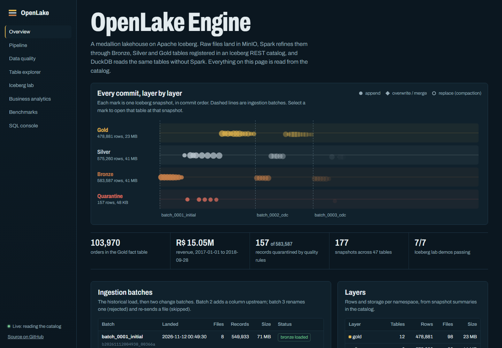
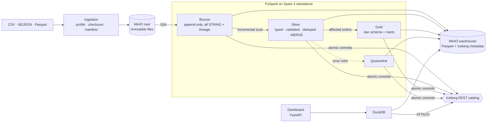
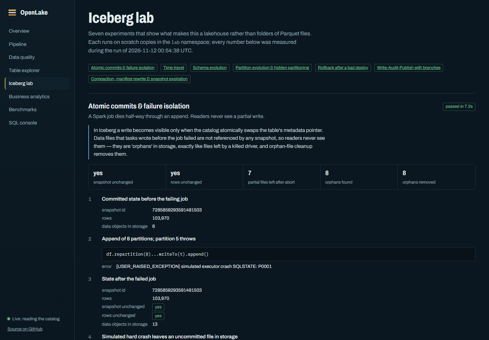
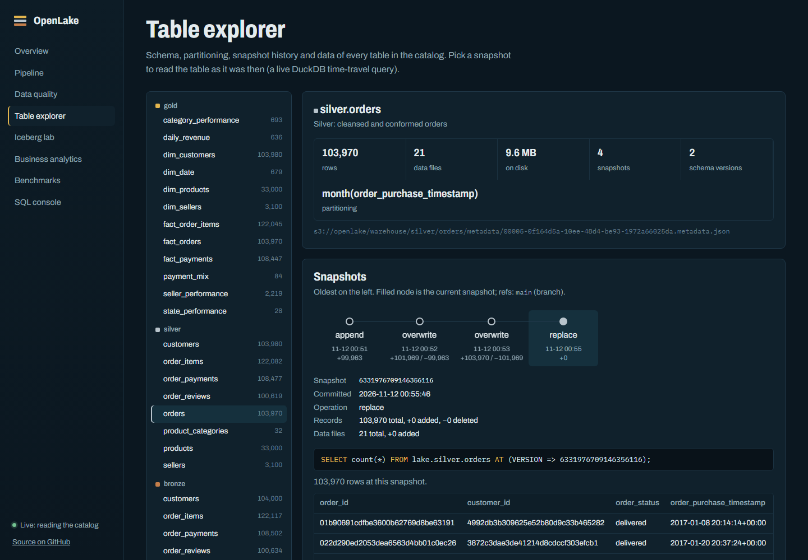
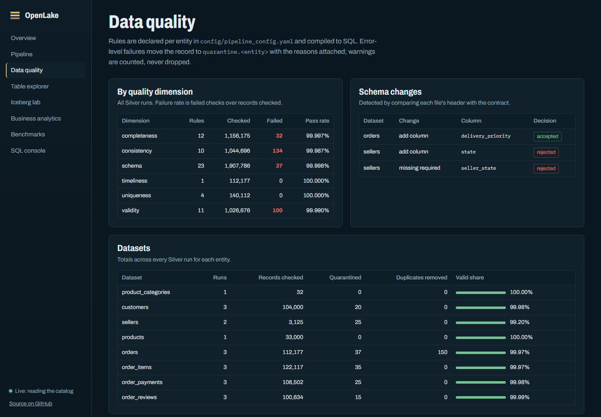
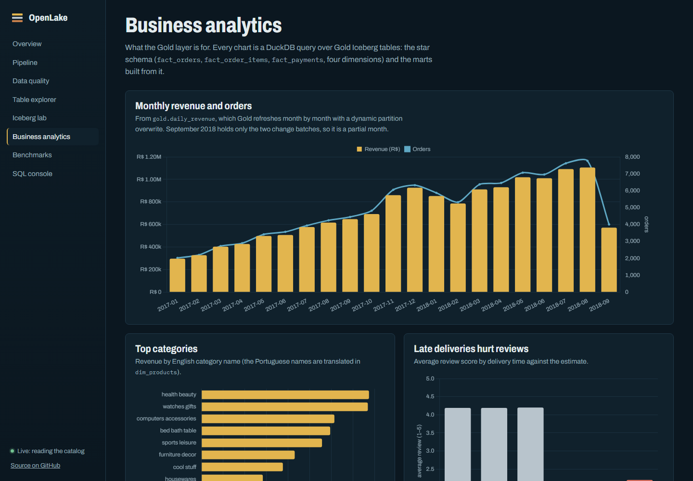

# OpenLake Engine

**A containerized Apache Iceberg lakehouse: MinIO + Iceberg REST catalog + PySpark + DuckDB, organised as a medallion architecture.**

[](https://github.com/AbidZakaria/openlake-engine/actions/workflows/ci.yml)


**[Live dashboard (static snapshot of a real run) →](https://abidzakaria.github.io/openlake-engine/)**



OpenLake is a lakehouse you can run on a laptop with one command. Raw files land in
S3-compatible object storage, PySpark refines them through **Bronze → Silver → Gold**
Iceberg tables registered in a **REST catalog**, and **DuckDB** queries the same tables
without Spark. It is built to show the engineering a lakehouse actually needs, not just
three folders of Parquet files named after metals:

- **A real table format and catalog.** Every dataset is an Iceberg v2 table. Writers commit atomically through the REST catalog; a second engine discovers the same tables by name.
- **Incremental processing.** Silver reads only new Bronze data with Iceberg *incremental append scans*; changed records are upserted with `MERGE INTO`; Gold recomputes only affected orders and swaps changed months in with a dynamic partition overwrite.
- **Schema evolution with a policy.** A new upstream column is accepted and evolves Silver and Gold; a renamed required column gets the whole file rejected and quarantined. Every decision is logged.
- **Data quality as configuration.** Declarative rules in YAML are compiled to SQL and evaluated in one pass; failures go to quarantine tables with the reasons attached.
- **Iceberg features, demonstrated on real data.** Atomic commits under failure, time travel from Spark *and* DuckDB, schema and partition evolution, rollback with tags, write-audit-publish with branches, compaction, snapshot expiry and orphan cleanup.
- **Observability and lineage.** Every run records records in/out, quarantined rows, duration and the Iceberg snapshot it produced, in Iceberg tables you can query.
- **Honest benchmarks.** Raw CSV vs raw Parquet vs Silver vs Gold, measured, with the methodology and the trade-offs written down.

## Quick start

Requirements: Docker with ~8 GB of memory for the Docker VM (a 16 GB laptop is fine).

```bash
git clone https://github.com/AbidZakaria/openlake-engine.git
cd openlake-engine
docker compose up --build -d
docker compose logs -f openlake    # watch the bootstrap; about 8 minutes the first time
```

Then open:

| | |
|---|---|
| Dashboard | http://localhost:8501 |
| MinIO console | http://localhost:9001 (user `openlake`, password `openlake-secret`) |
| Spark master UI | http://localhost:8080 |
| Iceberg REST catalog | http://localhost:8181/v1/namespaces |

The first `up` runs an idempotent **bootstrap**: it generates the dataset, processes
three batches one after another (so the lakehouse has a genuine incremental history),
runs the Iceberg lab, table maintenance and the benchmarks. Later `up`s skip it.

## What happens in the demo

| Batch | Contents | What the platform does |
|---|---|---|
| `batch_0001_initial` | 100k orders, 550k records across 8 files (CSV, NDJSON, Parquet), including 342 deliberately corrupted rows (some fixable, some not) | Lands the files, loads Bronze, quarantines 132 records, removes 150 duplicate rows, builds Silver and the Gold star schema |
| `batch_0002_cdc` | 2,000 new orders and 6,001 status updates (`shipped` → `delivered`, some → `canceled`); the orders feed gains a new column, `delivery_priority` | Reads Bronze incrementally, accepts the additive schema change (Silver and Gold gain the column), MERGEs the updates, recomputes only the affected Gold months |
| `batch_0003_cdc` | More updates; a sellers file where upstream renamed `seller_state` to `state`; a file re-sent unchanged | Rejects the breaking file and quarantines its 25 rows with `schema_contract`, skips the duplicate file by checksum, processes the rest |

Results from the run that produced the screenshots (`docs/benchmarks.md` has everything):

| | |
|---|---|
| End-to-end bootstrap from an empty machine | **7 min 53 s** (3 batches, lab, maintenance, benchmarks) |
| Records validated / quarantined / deduplicated | 583,587 / 157 / 150 |
| Tables / snapshots in the catalog | 47 / 177 |
| Monthly revenue query, DuckDB: raw CSV → Gold | 270 ms → 20 ms (**13.8×**) |
| One-day filter, DuckDB: raw CSV → Silver | 175 ms → 17 ms, reading 0.6 MB instead of 16.6 MB (partition pruning) |
| Compaction of 40 micro-batches | 80 files → 1, 40 manifests → 1, query 648 ms → 152 ms |
| Rollback after a bad deploy | 87 ms, revenue restored to the cent |
| Tests | 71 passing (unit, hermetic Spark pipeline, live-stack integration) |

## Architecture



| Component | Technology | Role |
|---|---|---|
| Object storage | MinIO (`pgsty/minio` community build) | raw files, Iceberg data and metadata files |
| Table format | Apache Iceberg 1.10 (format v2) | ACID commits, snapshots, schema & partition evolution |
| Catalog | Iceberg REST catalog, SQLite on a volume | table name → current metadata pointer |
| Processing | Spark 4.0.1 standalone + PySpark | every write: ingestion to Gold, maintenance |
| Query | DuckDB 1.4 with the `iceberg` extension | reads, analytics, dashboard, benchmarks |
| Orchestration | ~100 lines of Python | runs stages in order; no Airflow on purpose |
| Infrastructure | Docker Compose | one command, persistent volumes |

More detail: [architecture](docs/architecture.md) · [medallion layers](docs/medallion_architecture.md) ·
[Iceberg features](docs/iceberg_features.md) · [data quality](docs/data_quality.md) · [benchmarks](docs/benchmarks.md)

## The dashboard

A FastAPI + vanilla JS app that reads **only** through DuckDB and the REST catalog. The
same pages are published as a static snapshot on GitHub Pages.

| | |
|---|---|
|  |  |
| **Iceberg lab:** seven experiments with the SQL they ran and the numbers they measured | **Table explorer:** schema with field IDs, schema and partition history, and live time travel to any snapshot |
|  |  |
| **Data quality:** rules by dimension, schema decisions, quarantine with reasons | **Business analytics:** the Gold layer answering business questions |

Also: pipeline runs and lineage, benchmarks, and a read-only SQL console (`AT (VERSION => …)` works).

## Iceberg, demonstrated

`make showcase` (or `python3 -m openlake showcase`) runs these on scratch copies in the `lab` namespace:

| Experiment | What it proves |
|---|---|
| Atomic commits | an append whose 6th task crashes leaves the snapshot and row count unchanged; leftover files are invisible orphans that `DeleteOrphanFiles` removes |
| Time travel | `VERSION AS OF` / `TIMESTAMP AS OF` in Spark and `AT (VERSION => …)` in DuckDB return identical counts; one order is followed from `shipped` to `delivered` across snapshots |
| Schema evolution | add, rename, widen `INT→BIGINT` and `FLOAT→DOUBLE`, reorder, drop: **0 data files rewritten**; old snapshots keep their schema |
| Partition evolution | `months(ts)` → `days(ts)` on a live table; both specs coexist and one query reads both |
| Rollback | tag, bad `UPDATE` (×100), `rollback_to_snapshot` in under 100 ms |
| Write-audit-publish | stage on an `audit` branch, catch a bad row, fix it, `fast_forward` main |
| Compaction & expiry | 80 → 1 files, 40 → 1 manifests, 42 → 3 snapshots, 4.2× faster aggregation |

## Commands

Everything runs in containers; `make help` lists the targets.

```bash
make up            # build + start (first start runs the full demo)
make simulate BATCH=4 && make run   # generate another CDC batch and process it incrementally
make quality       # latest quality reports
make status        # every table: snapshots, files, bytes, rows
make query SQL="SELECT * FROM lake.gold.daily_revenue ORDER BY order_date DESC LIMIT 7"
make showcase      # Iceberg lab
make optimize      # compaction, manifest rewrite, snapshot expiry, orphan cleanup
make benchmark     # regenerates docs/benchmarks.md
make test          # unit + Spark + integration tests
make clean         # delete all data and volumes
```

Without `make`: `docker compose run --rm openlake python3 -m openlake <command>`.

## Using the real Olist dataset

The [Brazilian E-Commerce Public Dataset by Olist](https://www.kaggle.com/datasets/olistbr/brazilian-ecommerce)
needs a Kaggle account, so the platform ships a deterministic generator that reproduces its
eight files, column names (including the `product_name_lenght` typo) and realistic
distributions: state populations, the category mix, payment types, delivery times by region,
and review scores that fall with late deliveries. To use the real data instead, download it
into `data/olist/` and run:

```bash
docker compose run --rm openlake python3 -m openlake ingest --path data/olist --label olist_real
make run
```

The contract in `config/pipeline_config.yaml` is the same; `olist_geolocation_dataset.csv`
has no entity and is reported as `REJECTED` at ingestion.

## Repository layout

```
config/pipeline_config.yaml   data contract: entities, keys, types, rules, evolution + maintenance policy
openlake/
  ingestion/                  format adapters (CSV, JSON, Parquet), batch manager, duplicate detection
  pipeline/                   bronze, silver, gold, incremental reads, ops logging, orchestrator, bootstrap
  transformations/            cleaning, standardization, deduplication, dimensional modeling, aggregations
  quality/                    rule compiler, one-pass validator, quality reports
  iceberg/                    catalog, snapshots, schema evolution policy, rollback, maintenance, lab
  analytics/                  DuckDB client (REST catalog attach) and example queries
  benchmarks/                 query + ingestion benchmarks, report generator
  datagen/                    Olist-shaped generator and CDC simulator
dashboard/                    FastAPI API, static front end, static snapshot exporter
docker/                       Spark/Iceberg image, dashboard image
tests/                        unit, Spark (hermetic pipeline on a filesystem catalog), integration
docs/                         architecture, layers, Iceberg features, quality, benchmarks
```

## Testing

```bash
make test-unit         # 45 tests, pure Python: config, ingestion, rule compiler, schema policy, generator, SQL guard
make test-spark        # 21 tests: transformations, Iceberg behaviours, and the full pipeline over 3 batches
                       # on a local filesystem catalog (no services)
make test-integration  # checks against the running stack: storage, catalog, DuckDB time travel, reconciliation
```

CI runs the unit and Spark tiers on every push (the Spark tier pulls the Iceberg runtime from
Maven) and builds both images.

## Design decisions and trade-offs

- **Iceberg only, no Delta.** One format, used deeply, rather than two integrated shallowly.
- **REST catalog instead of a Hadoop/path catalog.** Commits are atomic at the catalog, and DuckDB can find tables by name.
- **Copy-on-write.** Updates rewrite files instead of adding delete files: slower small upserts, but simple and fast reads for every engine. One table property switches to merge-on-read.
- **Bronze keeps everything as text.** No record is lost to a parsing or business rule before it is queryable; typing happens in Silver, where failures are reportable.
- **A file is accepted or rejected as a whole.** A rename shows up as "column added + column missing"; applying the additive half alone would corrupt the schema.
- **Deterministic surrogate keys** (`xxhash64(business key)`) let facts be recomputed incrementally without dimension lookups.
- **DuckDB for reads.** At this scale a single DuckDB process answers the benchmark queries 6–14× faster than Spark, whose per-query scheduling overhead dominates. Spark earns its place on the write side.
- **Silver storage cost.** Silver is larger than a raw Parquet copy because of lineage columns, including a sha256 record hash used for change detection. That's a deliberate trade for traceability.

## Limitations and next steps

- The REST catalog is the Apache reference implementation with SQLite. Production would use Polaris, Nessie, Lakekeeper or a managed catalog, with authentication.
- Dimensions are SCD type 1. SCD2 customer history would be a natural extension, and Iceberg's snapshots already keep the raw history.
- One Spark worker by default, sized for a laptop. More cores or memory are a `.env` change; more workers are extra services in the compose file.
- Gold marts other than `daily_revenue` are rebuilt in full; they are small, but partitioned incremental refresh would be the next step at larger scale.

## Part of a three-project portfolio

| Project | Domain | Stack |
|---|---|---|
| DZ News Pulse | batch ELT and orchestration | Airflow · dbt · PostgreSQL · FastAPI |
| StreamPulse Engine | real-time streaming and anomaly detection | Kafka · Spark Structured Streaming · PostgreSQL |
| **OpenLake Engine** | **lakehouse storage and distributed processing** | **MinIO · Iceberg · PySpark · DuckDB** |

## License

MIT
