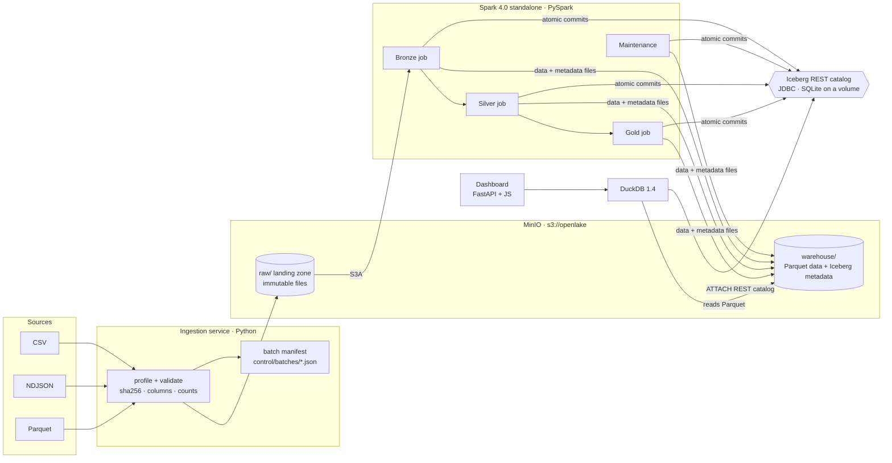

# Architecture



## Components and responsibilities

| Component | Image | Responsibility |
|---|---|---|
| **MinIO** | `pgsty/minio` (community build of MinIO) | S3-compatible storage for raw files, Iceberg data files and Iceberg metadata files |
| **Iceberg REST catalog** | `apache/iceberg-rest-fixture:1.10.0` | Owns the pointer from each table name to its current `metadata.json`; commits are compare-and-swap on that pointer. Backed by SQLite on a named volume so it survives restarts |
| **Spark master + worker** | `openlake/spark` (Spark 4.0.1 + Iceberg 1.10.0 + hadoop-aws) | Distributed execution for every write |
| **openlake** (driver) | same image | Runs the CLI / bootstrap; Spark driver in client mode |
| **DuckDB** | inside `openlake` and `dashboard` | Independent read engine that attaches the same REST catalog |
| **dashboard** | `openlake/dashboard` (FastAPI) | Read model over the catalog and `ops` tables; no Spark on the read path |

## Key decisions

**Iceberg is the only table format.** Supporting Delta as well would double the
integration surface without demonstrating anything new. Every Bronze, Silver,
Gold, quarantine and ops dataset is an Iceberg v2 table.

**The catalog is a service, not a folder convention.** Writers commit through
the REST catalog, which makes commits atomic (optimistic concurrency on the
metadata pointer) and lets a second engine (DuckDB) discover tables by name.
MinIO stores files; it does not decide what the current table state is.

**Raw files and Bronze tables are different things.** The landing zone keeps
every source file byte-for-byte (`raw/<source>/<entity>/ingest_date=…/batch_id=…`).
Bronze *also* registers that content as append-only Iceberg tables so it is
queryable, snapshotted and incrementally consumable.

**Copy-on-write tables.** Updates rewrite affected files instead of writing
delete files. Frequent small upserts would be cheaper with merge-on-read, but
copy-on-write keeps every reader (DuckDB included) on plain Parquet and keeps
read performance predictable. It is one table property to change.

**No Airflow.** Scheduling is not what this project is about; a ~100-line Python
orchestrator runs the stages in order and records every run in `ops.pipeline_runs`.

**Spark for writes, DuckDB for reads.** On ~100k orders a single DuckDB process
answers analytical queries far faster than a Spark job can be scheduled (see
[benchmarks](benchmarks.md)). Spark earns its place on the write side:
distributed MERGE, compaction and maintenance actions.

## Storage layout

```
s3://openlake/
├── raw/ecommerce/<entity>/ingest_date=YYYY-MM-DD/batch_id=<id>/<original file>
├── control/
│   ├── batches/<batch_id>.json        batch manifests (status per file)
│   ├── checksums/<sha256>.json        duplicate-file index
│   └── bootstrap.json                 demo completion marker
├── warehouse/
│   ├── bronze/<entity>/{data,metadata}/
│   ├── silver/<entity>/…
│   ├── gold/<model>/…
│   ├── quarantine/<entity>/…
│   ├── ops/<table>/…
│   └── lab/<demo table>/…
└── bench/                             benchmark scratch data (raw Parquet copy)
```

## Resource sizing

Defaults target a 16 GB laptop where Docker gets ~8 GB: one worker with 2 cores
and 3 GB, a 2 GB driver, 8 shuffle partitions. All of it is configurable in
`.env` (see `.env.example`). The full demo (generate → 3 batches → lab →
maintenance → benchmarks) takes about 10 minutes on that budget.
